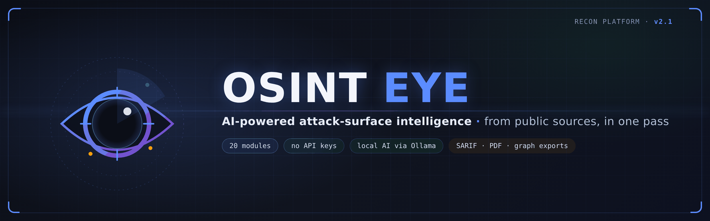
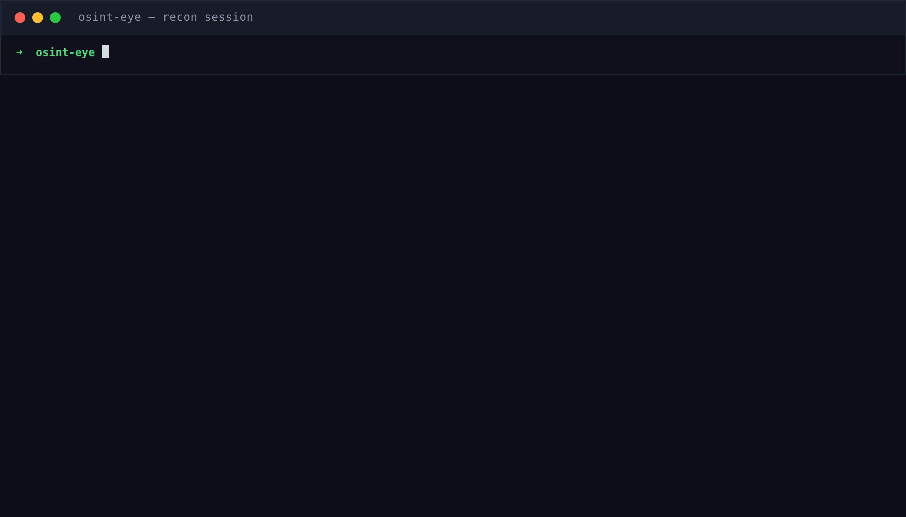
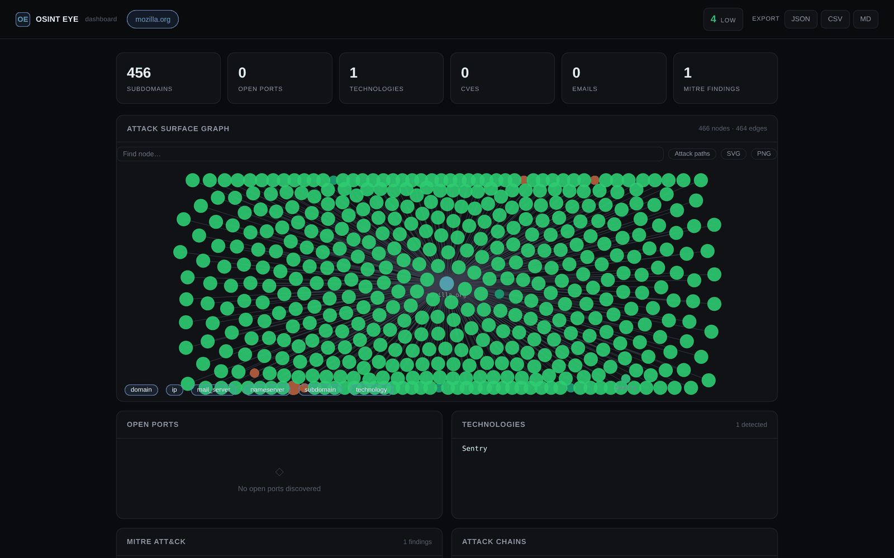
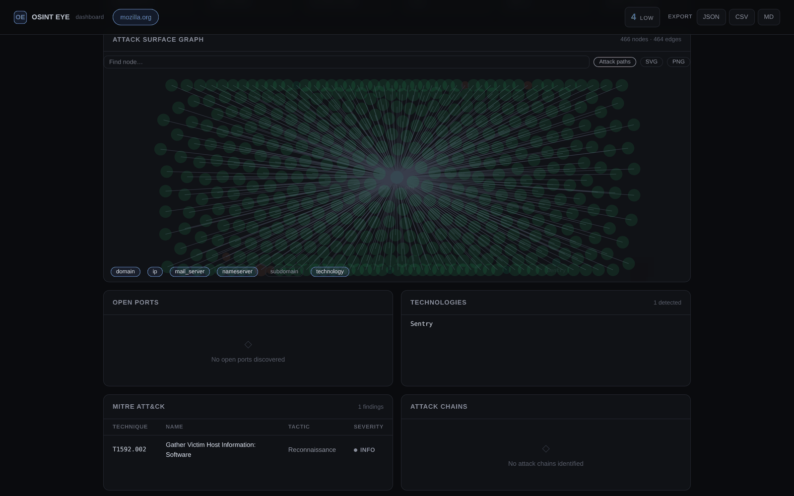
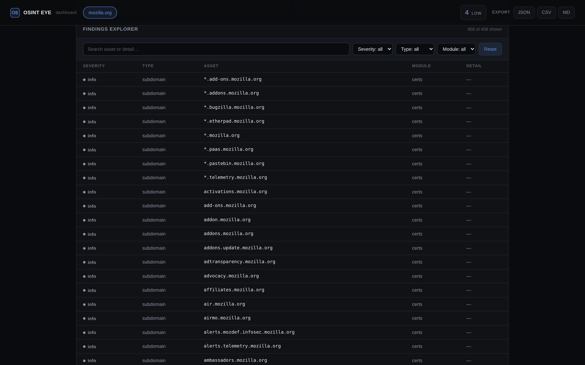

<div align="center">



[](https://www.python.org/)
[](LICENSE)
[](CHANGELOG.md)
[](.github/workflows/ci.yml)
[](tests/)
[]()

<br />

**Automated recon from public sources · 100% free · Local AI via Ollama**

*English README — reference in Spanish: [`README.es.md`](README.es.md)*

</div>

---

## What is OSINT EYE?

**OSINT EYE** is a modular **OSINT** (*Open-Source Intelligence*) and **attack-surface reconnaissance** platform. It collects from public sources — DNS records, *certificate transparency* logs, the Wayback Machine, WHOIS, GitHub code search, Google dorks and the NVD/CVE database — then **correlates** everything into actionable intelligence: a weighted attack-surface score, a relationship graph, potential multi-step attack chains, MITRE ATT&CK mapping and canonical findings exportable as SARIF.

Built for pentesters, bug-bounty hunters, SOC analysts and security researchers. No API keys, no cost, no cloud: the optional AI runs locally with Ollama.

**Every claim below is checkable**: flags against `python osint_eye.py --help`, the module list against `--modules`, the test count against the suite, and the export list against an actual `-o` run.

---

## See it in action

One command, real output — a live reconnaissance session against `mozilla.org` (passive modules only):

<div align="center">



*Real `--rich` output: module progress, CT-subdomain discovery, attack-surface score and the full export catalogue. Rendered from an actual capture — not scripted.*

</div>

---

## Highlights

- **Zero friction** — `pip install -r requirements.txt` and go; no API key for any module.
- **20 collector & analysis modules** — run them all, or pick exactly what you need with `--modules`.
- **Authorization scope** — `--scope FILE` / `--exclude` gates every active probe; anything out of scope is skipped *and recorded*.
- **CI-ready** — `--fail-on low|medium|high` turns the worst severity into an exit code your pipeline can gate on.
- **Professional outputs** — JSON, Markdown, HTML, PDF, CSV, Burp XML, Metasploit JSON, MITRE Navigator, SARIF 2.1 and a self-contained HTML graph, all in one pass.
- **Real logging** — `core/`, `graph/` and `reporting/` log through the `osint_eye` tree (`--log-level`, `--log-file`); Rich stays the only user-facing output.
- **Tested** — 863 offline tests and CI on GitHub Actions against Python 3.10/3.11/3.12.

---

## Web dashboard

Launch it after a scan, or replay any previous one:

```bash
python osint_eye.py example.com --dashboard
# or load a previous scan:
python ui/dashboard.py output/my_scan.json   # → http://127.0.0.1:5000
```

Dark, minimalist UI that listens only on `127.0.0.1` and renders 100% offline (no CDN). KPIs, interactive attack-surface graph, findings explorer with full-text search and severity/type/module filters, multi-scan selector with diff view, and one-click JSON/CSV/MD export. All content is rendered via `textContent` (injection-proof) and the REST API never returns a 500 on malformed data.

<div align="center">

**Overview** — KPIs and the full attack-surface graph of a real `mozilla.org` scan (466 nodes · 464 edges):



<br /><br />

**Attack paths** — one click highlights routes from the domain hub to risky assets:



<br /><br />

**Findings explorer** — 458 assets from one passive pass, filterable by severity, type and module:



</div>

REST API: `/api/scans` and `/api/scan/<target>` with `/summary`, `/assets`, `/diff`, `/export`, `/subdomains`, `/ports`, `/graph`, `/mitre` and `/chains`.

---

## Quickstart

**Requirements**: Python 3.10+ · optional: `nmap` and `whois` binaries on PATH for the network modules.

```bash
git clone https://github.com/Ruby570bocadito/OSINT-EYE.git
cd OSINT-EYE

python -m venv venv
source venv/bin/activate        # Windows: venv\Scripts\activate

pip install -r requirements.txt
python osint_eye.py --help
```

Editable install with the standard entry point:

```bash
pip install -e .                # extras: [ui] (flask/textual), [pdf] (reportlab), [dev] (pytest/ruff)
osint-eye --help
```

**Docker** (bundles nmap and whois):

```bash
docker build -t osint-eye .
docker run --rm -v "$PWD/output:/app/output" osint-eye example.com --no-ai
```

**Local AI (optional, fully offline):**

```bash
# https://ollama.ai
ollama pull llama3.2
python osint_eye.py example.com --agent   # generates an actionable playbook
```

---

## First scans

```bash
# Full scan (4 concurrent phases)
python osint_eye.py example.com

# Only specific modules, in this order
python osint_eye.py example.com --modules dns certs wayback cloud graph mitre

# Catalog of every module
python osint_eye.py --modules

# Stealth mode (fewer requests, no dorking)
python osint_eye.py example.com --stealth

# Depth presets
python osint_eye.py example.com --depth quick     # phase 1 + web + analysis
python osint_eye.py example.com --depth full      # everything, including endpoints/buckets/takeover

# Multiple targets + diff between them
python osint_eye.py target1.com target2.com --diff

# Authorization scope + exclusions: nothing out of scope is touched
python osint_eye.py example.com --scope scope.txt --exclude sub.example.com --exclude 10.0.0.0/8

# CI mode: exit 1 when the worst severity reaches the threshold
python osint_eye.py example.com --fail-on medium

# Everything exportable + executive PDF report
python osint_eye.py example.com -o output/my_scan --pdf

# Monitor daemon: webhook alert whenever new surface appears
python osint_eye.py example.com --monitor --monitor-interval 3600 \
    --webhook https://hooks.slack.com/services/xxx

# Web dashboard after the scan
python osint_eye.py example.com --dashboard

# No arguments: interactive wizard (asks scope, asks for explicit authorization)
python osint_eye.py
```

### Exit codes (CI)

| Code | Meaning |
|------|---------|
| `0` | Scan finished under the `--fail-on` threshold |
| `1` | `--fail-on` threshold reached or exceeded (`high` also fails on critical) |
| `2` | Usage error (bad arguments, invalid scope file…) |
| `3` | No target scanned (everything outside scope) |

---

## Authorization scope

Nothing outside the declared scope is ever touched:

```text
# scope.txt — one pattern per line (# comments)
example.com
*.example.com
192.0.2.0/24
```

- Patterns: domains, wildcard domains (`*.example.com`), IPv4/IPv6 addresses and CIDR ranges.
- `--exclude` entries **always win** over `--scope`.
- Targets and candidates rejected by scope (permutations, takeover probes) are recorded in `results["scope"]["discarded"]` with target, module, reason and timestamp.
- An invalid scope file is a clean usage error before any scan starts.
- The interactive wizard asks for scope/exclusions and requires explicit authorization before running active modules.

---

## Modules

| Module | What it does |
|--------|--------------|
| `dns` | DNS enumeration (A/AAAA/MX/NS/TXT/CNAME/SOA), SPF/DMARC, email-security audit (DKIM, MTA-STS, TLS-RPT, BIMI) with an explicable spoofing score, subdomain bruteforce + 5 passive sources (HackerTarget, AlienVault OTX, Anubis, RapidDNS, CertSpotter), wildcard detection and permutations |
| `certs` | Certificate transparency via crt.sh |
| `tls_audit` | TLS configuration audit with letter grade (protocol versions, cipher strength) |
| `wayback` | Wayback Machine URL history and snapshot timeline |
| `network` | Port & service scanning via nmap (optional; skipped with a notice if absent) |
| `whois` | Domain registration and ownership data |
| `github` | GitHub code dorking: API keys, secrets, exposed configs |
| `google` | Google dorking: admin panels, sensitive files, backups |
| `cve` | NVD/CVE lookup for discovered services |
| `web` | HTTP technology fingerprinting + security-headers audit |
| `endpoints` | JS/HTML endpoint discovery + sensitive-file probing |
| `cloud` | Bucket discovery (S3/GCP/Azure) and public exposure |
| `emails` | Email enumeration from WHOIS and public sources |
| `permutation` | Subdomain permutation generation and resolution |
| `takeover` | Dangling-CNAME subdomain takeover detection |
| `cdn_waf` | CDN and WAF fingerprinting |
| `correlation` | Cross-asset correlation + attack-surface score |
| `graph` | Relationship graph with interactive HTML visualization |
| `mitre` | MITRE ATT&CK mapping + Navigator layer export |
| `chains` | Multi-step attack-chain hypotheses |

All collectors share one HTTP client (`modules/_http.py`) with sane timeouts, exponential backoff on transient errors, a configurable User-Agent, per-host rate limiting and optional proxy support.

---

## Exports

A single run with `-o BASE` produces:

| File | Content |
|------|---------|
| `BASE.json` | Complete scan results (versioned schema, `results.schema_version`) |
| `BASE.md` / `BASE.html` / `BASE.pdf` | Human-readable reports (PDF = executive ReportLab report) |
| `BASE.sarif` | SARIF 2.1 findings (takeover, public buckets, secrets, CVEs, sensitive files) for GitHub Code Scanning |
| `BASE_subdomains.csv` / `BASE_ports.csv` / `BASE_emails.csv` / `BASE_cves.csv` | Per-asset CSVs |
| `BASE_mitre.json` / `BASE_navigator.json` | MITRE mapping / Navigator layer |
| `BASE_graph.html` | Self-contained interactive graph (inline JS, no CDN) |
| `BASE_burp.xml` / `BASE_msf.json` | Burp Suite XML / Metasploit JSON |
| `bounty_report_<target>.md` | Bug-bounty oriented summary |

```bash
python osint_eye.py example.com -o output/recon_demo --pdf
```

Which formats get written is also configurable from a TOML file (`[exports].formats`) — see below.

---

## Configuration file (TOML)

```bash
python osint_eye.py example.com --config osint_eye.toml
python osint_eye.py example.com --config osint_eye.toml --profile deep
```

If `osint_eye.toml` exists in the current directory it is loaded by default:

```toml
[scan]
depth = "normal"            # quick | normal | deep | full
stealth = false
no_ai = false
no_cache = false
modules = ["dns", "certs"]

[timeouts]
monitor_interval = 3600

[scope]
includes = ["example.com"]  # same syntax as --scope
excludes = ["10.0.0.0/8"]

[exports]
formats = ["json", "sarif"] # subset of the export catalogue

[profiles.deep]
[profiles.deep.scan]
depth = "full"
```

Precedence: CLI flags > selected profile > file. Unknown sections or keys are rejected at load time. Uses stdlib `tomllib` (Python 3.11+; on 3.10 everything else works, TOML is simply unavailable).

---

## Monitoring, plugins & AI

**Monitor daemon** — `--monitor` keeps scanning on an interval, baselines known subdomains on the first cycle and alerts only on new surface. `--webhook` posts `{"text": ...}` (Discord/Slack-compatible). `Ctrl+C` stops gracefully; the cache (`~/.osint_eye/`) feeds the diffs.

**Plugins** — drop your own in a directory and load them with `--plugin-dir ./plugins`:

```python
# my_plugin.py
class PluginTemplate:
    name = "my_plugin"
    author = "me"                      # anything but "built-in"

    async def run(self, target: str) -> dict:
        return {"finding": "example"}
```

Broken plugins are reported and skipped — they never abort a scan.

**Local AI** — with Ollama installed, `--agent` turns findings into an actionable playbook; everything talks only to `http://localhost:11434`. Without Ollama, the module degrades to `{"status": "unavailable"}` in milliseconds and the scan continues. `--no-ai` disables it entirely.

---

## Architecture

```mermaid
flowchart LR
    subgraph Collectors["📡 Collectors"]
        M1[dns · certs · wayback]
        M2[network · web · endpoints]
        M3[github · google · cloud · emails]
    end
    subgraph Core["⚙️ Core"]
        C[Asset Correlator]
        F[Findings Extractor]
        S[Scope Gate]
        P[Plugin System]
        D[SQLite Cache]
    end
    subgraph Analysis["📊 Analysis"]
        A1[Attack Surface Score]
        A2[Graph Builder]
        A3[MITRE Mapper]
        A4[Attack Chains]
        A5[AI Engine · Ollama]
    end
    subgraph Output["📤 Output"]
        O1[Rich CLI]
        O2[Dashboard Flask]
        O3[PDF · MD · HTML · CSV]
        O4[Burp · MSF · Navigator · SARIF]
    end
    Collectors --> Core --> Analysis --> Output
```



```text
osint_eye.py            # Orchestrator: phases, CLI, exports
├── modules/            # Collectors per source (dns, certs, web, network, osint, cve)
├── core/               # Correlator, schema, scope, findings, SQLite cache, monitor, plugins, diff
├── graph/              # NetworkX graph + pyvis/Neo4j export
├── reporting/          # PDF, Markdown, HTML, CSV, Burp, MSF, MITRE, SARIF
├── ui/                 # Rich CLI, wizard, Textual TUI, Flask dashboard
├── ai/                 # Local AI engine (Ollama)
└── tests/              # Offline test suite, one file per zone (pytest)
```

### Environment variables

| Variable | Effect |
|----------|--------|
| `OSINT_EYE_HTTP_TIMEOUT` | Shared HTTP client timeout in seconds (float; default 10) |
| `OSINT_EYE_RATE_LIMIT` | Per-host:port rate limit in seconds between requests (float; 0 = off) |
| `OSINT_EYE_USER_AGENT` | Custom User-Agent (default `OSINT-EYE/…`) |
| `OSINT_EYE_PROXY` | Optional proxy for all collector traffic |
| `NVD_API_KEY` | Optional NVD key: higher rate limit, 0.7 s pacing |
| `NO_COLOR` | Disable CLI colors (standard NO_COLOR) |

---

## Testing & CI

- **863 offline tests** — no network, no nmap, no Ollama; fixtures and monkeypatching only. Run with `PYTHONPATH=. pytest -q tests/`.
- **CI** (`.github/workflows/ci.yml`): ruff lint gate, pytest matrix on Python 3.10/3.11/3.12, coverage job (pytest-cov, Codecov) and a Docker build + smoke test.
- Compile check: `python -m compileall -q osint_eye.py core graph ai modules ui reporting tests`.

---

## Security & responsible use

This tool is intended for **passive/semi-passive OSINT reconnaissance on assets you own or are explicitly authorized to test** (in-scope bug bounty, contracted audits, labs). The network modules perform active requests — use them only within your authorized scope. The team is not responsible for misuse.

## 📚 Documentation

Full documentation lives under [`docs/`](docs/index.md), starting at the [documentation hub](docs/index.md):

- [Architecture](docs/architecture.md) — layers, data flow, safety guards
- [Modules](docs/modules/dns.md) — one page per built-in collector
- [Writing plugins](docs/plugins.md) — the `BaseModule` contract, end to end
- [FAQ](docs/FAQ.md) — keys, targets, exit codes, degradation behaviour

## Roadmap & contributing

The live plan (priorities, phase v2.3 «Intelligence», idea bank and per-agent tasks) lives in [`docs/agentes/ROADMAP.md`](docs/agentes/ROADMAP.md); release history in the [CHANGELOG](CHANGELOG.md). Extended CLI reference (Spanish): [`docs/USAGE.md`](docs/USAGE.md).

1. Fork the project
2. Create your feature branch (`git checkout -b feature/AmazingFeature`)
3. Commit (`git commit -m 'Add some AmazingFeature'`)
4. Push (`git push origin feature/AmazingFeature`)
5. Open a Pull Request

PRs with offline tests and no heavy new dependencies get priority.

## License

Distributed under the MIT license. See [`LICENSE`](LICENSE).

---

<div align="center">

**OSINT EYE** — *Open-Source Intelligence for the Modern Era*

[🐛 Report a bug](https://github.com/Ruby570bocadito/OSINT-EYE/issues) · [💡 Request a feature](https://github.com/Ruby570bocadito/OSINT-EYE/issues) · [📖 CHANGELOG](CHANGELOG.md)

</div>
