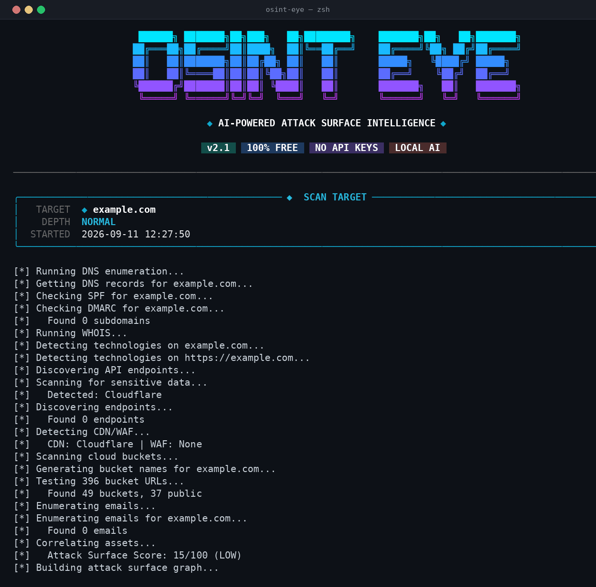
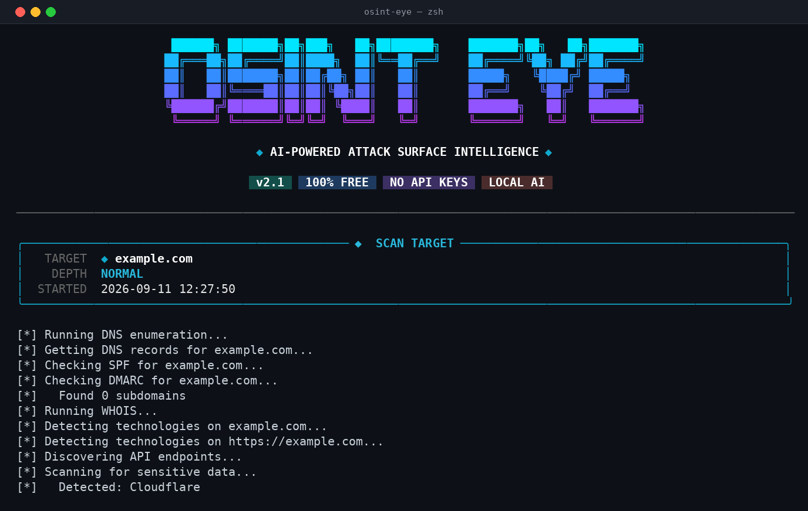
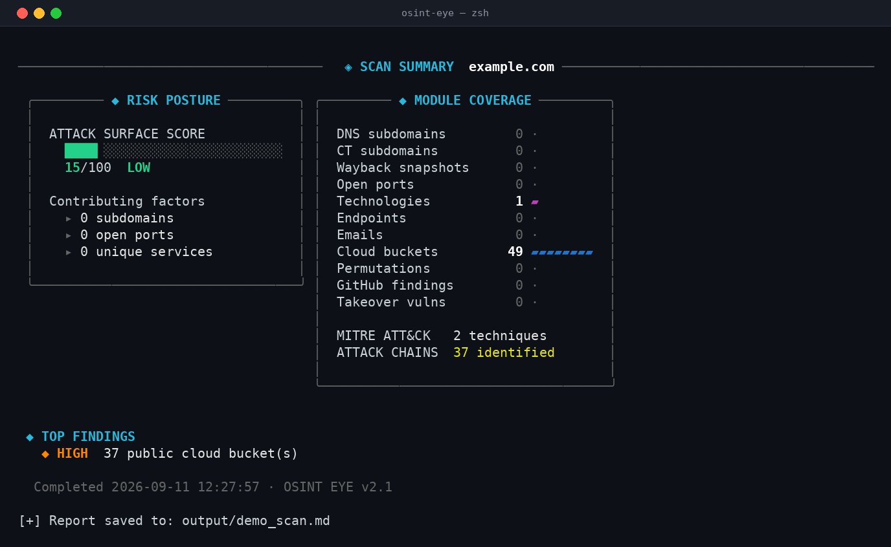
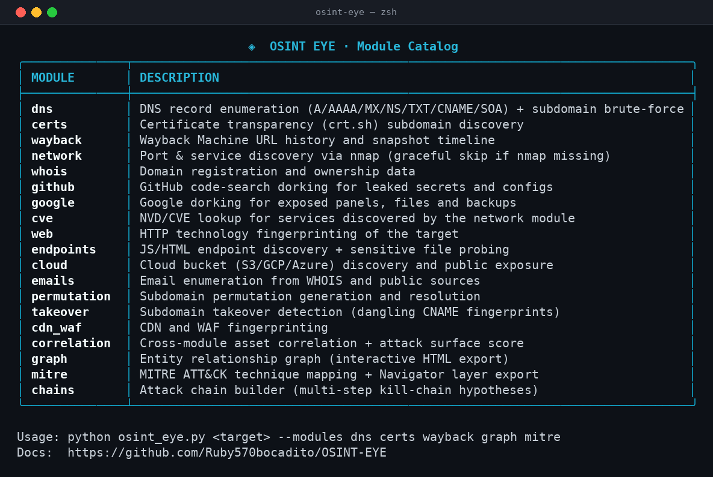
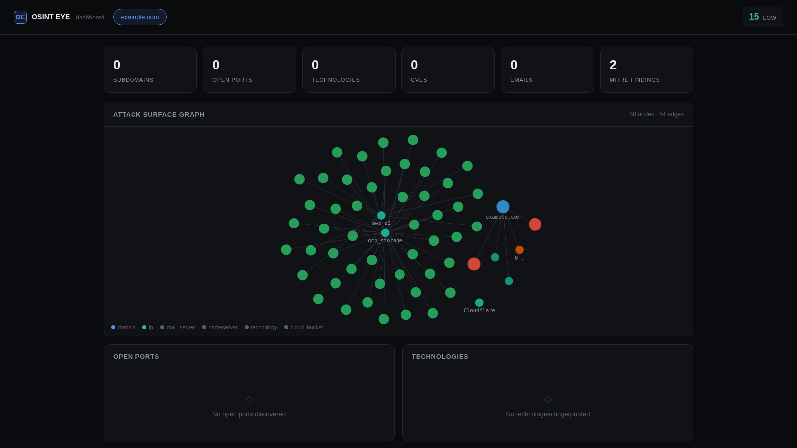
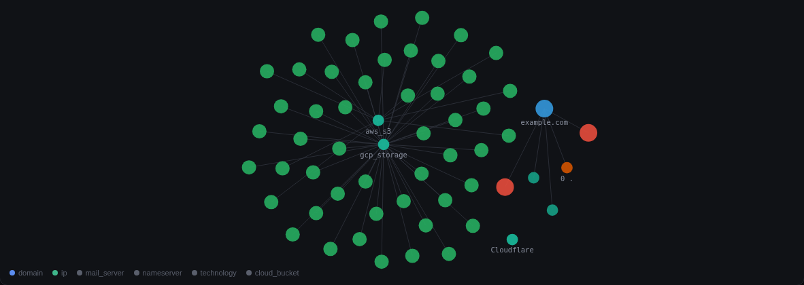

<div align="center">


[](https://www.python.org/)
[](LICENSE)
[](CHANGELOG.md)
[](.github/workflows/ci.yml)
[](tests/)
[]()

</div>

<h3 align="center">Recon automatizado desde fuentes públicas · 100% gratuito · IA local vía Ollama</h3>

---

## 📋 Tabla de contenidos

- [Demo](#-demo)
- [¿Qué es?](#-qué-es)
- [Módulos](#-módulos)
- [Instalación](#-instalación)
- [Uso rápido](#-uso-rápido)
- [Dashboard web](#-dashboard-web)
- [Exportación](#-exportación)
- [Arquitectura](#-arquitectura)
- [Roadmap](#-roadmap)
- [Seguridad y uso responsable](#-seguridad-y-uso-responsable)
- [Contribuir](#-contribuir)
- [Licencia](#-licencia)

---

## 🎬 Demo

> Escaneo real contra `example.com` (módulos DNS, WHOIS, web, endpoints, CDN/WAF, cloud buckets, correlación, grafo, MITRE y chains):



### Salida de la CLI

| Banner + arranque del escaneo | Resumen ejecutivo |
|---|---|
|  |  |

### Catálogo de módulos

```bash
python osint_eye.py --modules
```



### Dashboard web y grafo interactivo

| Dashboard Flask | Grafo de superficie de ataque |
|---|---|
|  |  |

---

## 🌐 ¿Qué es?

**OSINT EYE** es una plataforma modular de **OSINT** (*Open-Source Intelligence*) y **reconocimiento de superficie de ataque**. Automatiza la recolección desde fuentes públicas — registros DNS, logs de *certificate transparency*, Wayback Machine, WHOIS, búsqueda de código en GitHub, *dorking* en Google y la base NVD/CVE — y **corrrela** todos los hallazgos en inteligencia accionable: puntuación de superficie de ataque, grafo de relaciones, cadenas de ataque potenciales y mapeado a MITRE ATT&CK.

Diseñada para pentesters, bug bounty hunters, analistas SOC e investigadores de seguridad. Sin claves de API, sin costes, sin nube: la IA opcional corre en local con Ollama.

### Por qué OSINT EYE

- **Cero fricción**: `pip install -r requirements.txt` y listo — ninguna API key necesaria para ningún módulo.
- **Correlación real**: los hallazgos de todos los módulos se cruzan en un inventario unificado de activos con puntuación de riesgo ponderada.
- **Degradación elegante**: si falta `nmap` o una fuente externa está caída, el módulo se salta con un aviso claro y el escaneo continúa.
- **Salidas profesionales**: JSON, Markdown, HTML, PDF (ReportLab), CSV, Burp XML, Metasploit JSON, capa MITRE Navigator y grafo HTML interactivo — todo en una sola pasada.
- **Probado**: 61 tests unitarios que corren **offline** y CI en GitHub Actions contra Python 3.10/3.11/3.12.

---

## 🧩 Módulos

| Módulo | Descripción |
|--------|-------------|
| `dns` | Enumeración DNS (A/AAAA/MX/NS/TXT/CNAME/SOA), SPF/DMARC, fuerza bruta de subdominios |
| `certs` | Certificate transparency vía crt.sh |
| `wayback` | Historial de URLs y timeline de snapshots de Wayback Machine |
| `network` | Escaneo de puertos y servicios vía nmap (opcional, se salta si no está instalado) |
| `whois` | Datos de registro y propiedad del dominio |
| `github` | Dorking de código en GitHub: claves API, secrets, configs expuestas |
| `google` | Dorking en Google: paneles admin, ficheros sensibles, backups |
| `cve` | Consulta NVD/CVE para los servicios descubiertos |
| `web` | Fingerprinting de tecnologías HTTP |
| `endpoints` | Descubrimiento de endpoints JS/HTML + sondeo de ficheros sensibles |
| `cloud` | Descubrimiento de buckets (S3/GCP/Azure) y exposición pública |
| `emails` | Enumeración de emails desde WHOIS y fuentes públicas |
| `permutation` | Generación y resolución de permutaciones de subdominios |
| `takeover` | Detección de subdomain takeover (CNAMEs colgantes) |
| `cdn_waf` | Fingerprinting de CDN y WAF |
| `correlation` | Correlación cruzada de activos + attack surface score |
| `graph` | Grafo de relaciones con visualización HTML interactiva |
| `mitre` | Mapeado a MITRE ATT&CK + exportación de capa Navigator |
| `chains` | Constructor de cadenas de ataque (hipótesis multi-paso) |

---

## 📦 Instalación

**Requisitos**: Python 3.10+ · opcional: `nmap` y `whois` en el PATH para los módulos de red.

```bash
git clone https://github.com/Ruby570bocadito/OSINT-EYE.git
cd OSINT-EYE

python -m venv venv
source venv/bin/activate        # Windows: venv\Scripts\activate

pip install -r requirements.txt
python osint_eye.py --help
```

**Docker** (incluye nmap y whois):

```bash
docker build -t osint-eye .
docker run --rm -v "$PWD/output:/app/output" osint-eye example.com --no-ai
```

**IA local opcional** (sin claves, todo offline):

```bash
# https://ollama.ai
ollama pull llama3.2
python osint_eye.py example.com --agent   # genera un playbook de análisis IA
```

---

## 🚀 Uso rápido

```bash
# Escaneo completo (4 fases concurrentes)
python osint_eye.py example.com

# Solo módulos concretos
python osint_eye.py example.com --modules dns certs wayback cloud graph mitre

# Ver el catálogo de módulos
python osint_eye.py --modules

# Modo sigiloso (menos peticiones, sin dorking)
python osint_eye.py example.com --stealth

# Escaneo rápido
python osint_eye.py example.com --depth quick

# Profundidad completa con endpoints, buckets, emails, takeover y chains
python osint_eye.py example.com --depth full

# Múltiples objetivos + diff entre ellos
python osint_eye.py target1.com target2.com --diff

# Todo lo exportable + informe PDF ejecutivo
python osint_eye.py example.com -o output/mi_scan --pdf

# Playbook IA (requiere Ollama en local)
python osint_eye.py example.com --agent

# Monitor daemon: alerta por webhook cuando aparece superficie nueva
python osint_eye.py example.com --monitor --monitor-interval 3600 \
    --webhook https://hooks.slack.com/services/xxx

# Dashboard web tras el escaneo
python osint_eye.py example.com --dashboard

# Sin argumentos: asistente interactivo
python osint_eye.py
```

<details>
<summary><b>Referencia completa de flags</b></summary>

| Flag | Descripción |
|------|-------------|
| `targets` | Dominio(s) o IP(s) objetivo (posicional; vacío = asistente) |
| `--modules ...` | Ejecuta solo los módulos indicados; sin valores muestra el catálogo |
| `--depth quick\|normal\|deep\|full` | Profundidad del escaneo (default: `normal`) |
| `--stealth` | Modo sigiloso: menos peticiones y sin dorking |
| `-o, --output BASE` | Base de nombre para las exportaciones |
| `--pdf` | Informe PDF ejecutivo |
| `--rich` | Volcado completo de resultados con tablas Rich |
| `--diff` | Compara resultados entre múltiples objetivos |
| `--dashboard` | Lanza el dashboard web al terminar |
| `--monitor` | Daemon de monitorización continua |
| `--monitor-interval N` | Segundos entre ciclos del monitor (default: 3600) |
| `--webhook URL` | Webhook Discord/Slack para alertas del monitor |
| `--agent` | Playbook de análisis con IA local (Ollama) |
| `--no-ai` | Desactiva el módulo IA |
| `--no-cache` | Desactiva la caché SQLite de resultados |
| `--plugin-dir DIR` | Carga y ejecuta plugins propios |
| `--export-cypher FILE` | Exporta el grafo a Cypher (Neo4j) |
| `--profile default\|deep\|stealth` | Perfil de configuración predefinido |

</details>

---

## 🌐 Dashboard web

```bash
# Escanear y abrir dashboard
python osint_eye.py example.com --dashboard

# O cargar resultados previos
python ui/dashboard.py output/mi_scan.json
# → http://127.0.0.1:5000
```

Interfaz minimalista y oscura con KPIs del escaneo, grafo de superficie interactivo (layout de fuerzas propio, sin CDN — 100% offline), puertos/servicios, tecnologías, técnicas MITRE con severidad y cadenas de ataque ordenadas por riesgo. Todo el contenido se renderiza vía `textContent` (a prueba de inyección desde los datos del escaneo) y la API REST es defensiva: nunca devuelve 500 con datos malformados.

API REST: `/api/scans`, `/api/scan/<target>`, `/api/scan/<target>/summary`, `/ports`, `/graph`, `/mitre`, `/chains`.

---

## 📤 Exportación

Una pasada con `-o` genera: **JSON** (resultados completos), **Markdown**, **HTML**, **PDF**, **CSV** por tipo de activo, **Burp XML**, **Metasploit JSON**, **MITRE Navigator layer**, **informe bounty** y **grafo HTML interactivo** (autónomo, sin CDN).

```bash
python osint_eye.py example.com -o output/recon_demo --pdf
```

---

## 🏗 Arquitectura

```mermaid
flowchart LR
    subgraph Collectors["📡 Colectores"]
        M1[dns · certs · wayback]
        M2[network · web · endpoints]
        M3[github · google · cloud · emails]
    end
    subgraph Core["⚙️ Núcleo"]
        C[Asset Correlator]
        S[SQLite Cache]
        P[Plugin System]
    end
    subgraph Analysis["📊 Análisis"]
        A1[Attack Surface Score]
        A2[Graph Builder]
        A3[MITRE Mapper]
        A4[Attack Chains]
        A5[AI Engine · Ollama]
    end
    subgraph Output["📤 Salida"]
        O1[Rich CLI]
        O2[Dashboard Flask]
        O3[PDF · MD · HTML · CSV]
        O4[Burp · MSF · Navigator]
    end
    Collectors --> Core --> Analysis --> Output
```



```
osint_eye.py            # Orquestador: fases, CLI, exportación
├── modules/            # Colectores por fuente (dns, certs, web, network, osint, cve)
├── core/               # Correlator, caché SQLite, monitor, plugins, diff, async engine
├── graph/              # Grafo NetworkX + export pyvis/Neo4j
├── reporting/          # PDF, Markdown, HTML, CSV, Burp, MSF, MITRE
├── ui/                 # Rich CLI, wizard, TUI Textual, dashboard Flask
├── ai/                 # Motor IA local (Ollama)
└── tests/              # 61 tests offline (pytest)
```

---

## 🗺 Roadmap

- [x] Núcleo DNS/web/certificados (v1.0)
- [x] Motores de dorking GitHub/Google (v1.5)
- [x] Correlación, grafo, diff y bounty reports (v2.0)
- [x] Dashboard Flask + exportadores (v2.0)
- [x] IA local vía Ollama (v2.0)
- [x] **v2.1**: CLI renovada, score ponderado con buckets/takeovers, monitor daemon estable, tests offline, CI multi-versión, Docker non-root
- [ ] Integración Shodan / Censys (con clave propia)
- [ ] Alertas push (Telegram/Discord nativo)
- [ ] Análisis de tendencias entre escaneos históricos
- [ ] Marketplace de plugins de la comunidad

---

## ⚠️ Seguridad y uso responsable

Esta herramienta está pensada para **reconocimiento OSINT pasivo/semipasivo sobre activos propios o con autorización explícita** (bug bounty con scope, auditorías contratadas, laboratorios). Los módulos de red realizan peticiones activas — úsalos solo dentro del alcance autorizado. El equipo no se hace responsable del mal uso.

---

## 🤝 Contribuir

1. Fork del proyecto
2. Rama de feature (`git checkout -b feature/AmazingFeature`)
3. Commit (`git commit -m 'Add some AmazingFeature'`)
4. Push (`git push origin feature/AmazingFeature`)
5. Abre un Pull Request

Los PRs con tests (offline) y sin dependencias nuevas pesadas tienen prioridad.

---

## 📄 Licencia

Distribuido bajo licencia **MIT**. Ver [`LICENSE`](LICENSE).

---

<div align="center">

**OSINT EYE** — *Open-Source Intelligence for the Modern Era*

[🐛 Reportar bug](https://github.com/Ruby570bocadito/OSINT-EYE/issues) · [💡 Pedir feature](https://github.com/Ruby570bocadito/OSINT-EYE/issues) · [📖 CHANGELOG](CHANGELOG.md)

</div>
